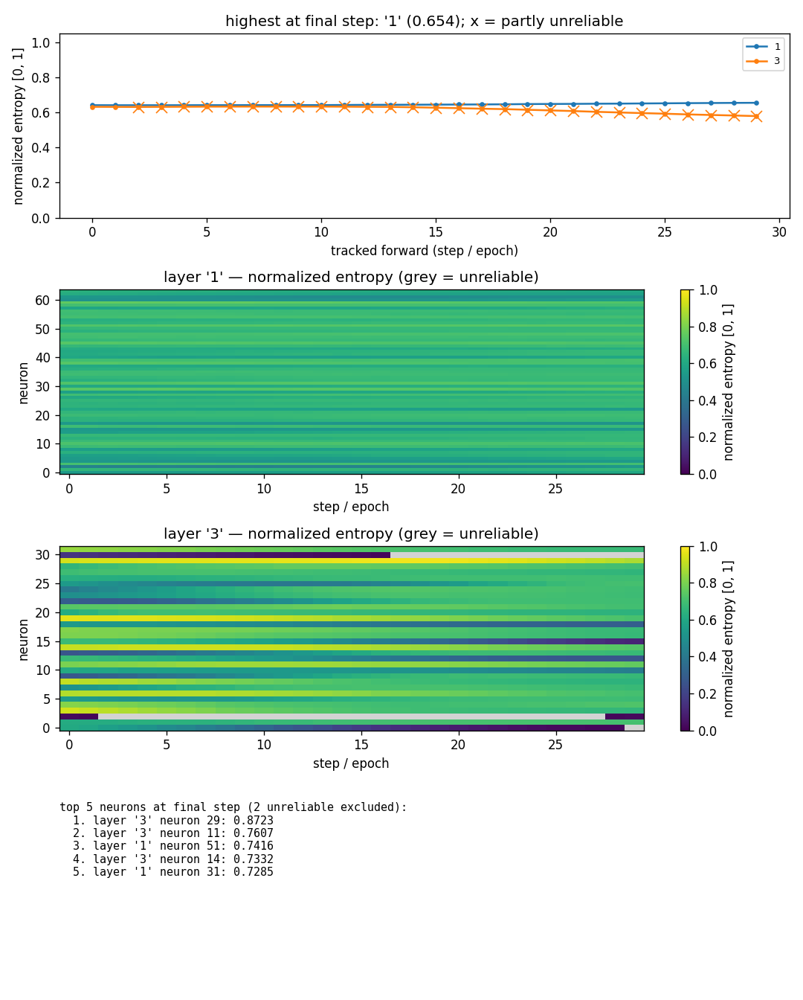

# entropylens

[](https://github.com/SashaRisoluti/entropylens/actions/workflows/tests.yml)

**Entropy-based statistical interpretability for PyTorch activations.**

entropylens measures *statistical* properties of a network's activation
distributions — how concentrated or spread out they are — while a model
runs or trains, without touching the model itself: the tracked forward
pass is **bitwise identical** to the untracked one, and nothing ever
enters the autograd graph.

> **What it does NOT claim:** entropylens says nothing about what a neuron
> *semantically* represents. High entropy = "this neuron's activations are
> spread out over the batch", nothing more. No semantic-interpretability
> claims, by design.



*Real output of `experiments/viz_demo.py`: an MLP trained for 30 epochs.
The dashboard names the highest-entropy layer, shows per-neuron heatmaps
over training, and lists the top-k neurons. Note the honest handling of
pathologies: dead ReLU neurons show up as dark rows (entropy → 0), and the
moment a neuron's estimate becomes degenerate the cell turns grey
("unreliable") instead of pretending to be a measurement.*

---

## Install

```bash
pip install torch            # only runtime dependency
pip install matplotlib       # optional, for entropylens.viz
# from a checkout:
pip install -e .             # or: pip install -e ".[viz]"
```

Python ≥ 3.11, torch ≥ 2.0. Tests: `pip install pytest && pytest tests/ -q`.

## Two metrics

| | Batch-wise | Per-example |
|---|---|---|
| Question | "How spread out is **this neuron** across the batch?" | "How spread out is **this example's** activation pattern across neurons?" |
| Input | `(N, M)` activations | `(N, M)` activations |
| Output | one entropy per neuron `(M,)` | one entropy per example `(N,)` |
| Estimator | quantile-winsorized histogram + Miller-Madow correction | normalized activation vector (strategy-dependent) |
| Bound | `log(min(N, B))` | `log(M)` |

Both are reported in nats **and** on a normalized `[0, 1]` scale
(entropy / its own attainable bound). Only the normalized scale is
comparable across layers of different width — the library's report and
plots use it by default and never show raw nats without their bound.

## Quickstart — functional API

```python
import torch
from entropylens import batch_wise_entropy, per_example_entropy

acts = torch.randn(512, 64)            # (batch, neurons)

r = batch_wise_entropy(acts)           # per-neuron
r.entropy      # (64,) nats, Miller-Madow corrected
r.normalized   # (64,) in [0, 1], comparable across layers
r.reliable     # (64,) bool — False = "not estimable", NOT "low entropy"

p = per_example_entropy(acts, "abs")   # per-example; strategy is MANDATORY
p.entropy      # (512,) nats; NaN where undefined (all-zero row)
p.valid        # (512,) bool mask
```

The per-example `strategy` (`"relu"` or `"abs"`) decides how negative
activations are handled and **must** be chosen explicitly — the two answers
differ by up to 8.6× on the same input, so a silent default would be a lie.
`entropylens.strategies` maps standard activation modules to the right one
(ReLU/GELU/Sigmoid/Softmax → `"relu"`, Tanh/Softsign/Hardtanh → `"abs"`),
with a documented motivation per entry; unmapped modules raise an explicit
error instead of guessing.

## Tracking a model during training

```python
import torch.nn as nn
from entropylens import EntropyTracker

model = nn.Sequential(nn.Linear(20, 64), nn.ReLU(),
                      nn.Linear(64, 32), nn.ReLU(),
                      nn.Linear(32, 2))

tracker = EntropyTracker(model)        # optionally layer_filter=...
for epoch in range(epochs):
    ...                                # normal training step, untracked
    tracker.attach()
    with torch.no_grad():
        model(x_eval)                  # one tracked forward = one step
    tracker.detach()

tracker.report().summary()             # normalized per-layer aggregates
tracker.report().depth_trend()         # entropy vs depth
```

Or as a context manager for one-off inspection:

```python
with EntropyTracker(model) as t:
    model(x)
t.report().summary()
```

Guarantees (all covered by `torch.equal` tests, i.e. exact, not "close"):

- **B1/B2** — outputs with and without tracking are bitwise identical;
- **B3** — gradients are bitwise identical; entropy tensors never require
  grad (everything runs under `torch.no_grad()` on detached tensors);
- conv / 4D+ feature maps are **skipped with an explicit warning**
  (spatial-independence assumption not validated in v1 — never silently
  computed).

There are also drop-in wrappers if you prefer building tracking into the
architecture: `EntropyReLU`, `EntropyTanh`, `EntropyGELU`, … and a generic
`EntropyActivation(module, strategy=...)` — same bitwise guarantees.

## TensorFlow and JAX (experimental)

Same estimators (MATH_DECISIONS.md D1–D6), same record schema, same report
and viz — via a numpy core validated for equivalence against the torch core
(D7). Install: `pip install entropylens[tf]` or `pip install entropylens[jax]`.

### TensorFlow / Keras

```python
from entropylens.tf import TFEntropyTracker

tracker = TFEntropyTracker(model)          # functional or Sequential
for epoch in range(epochs):
    train_one_epoch(model)
    tracker.observe(x_probe)               # extra inference-mode pass
print(tracker.report().summary())
```

Your model is **never modified** — observation runs a weight-sharing
auxiliary model (D8), so training outputs and gradients are invariant *by
construction* (exp7). Caveats: observation is inference-mode (BatchNorm /
Dropout differ from the training pass); subclassed models and nested
submodels are unsupported in v1 (no symbolic layer outputs / top-level
layers only).

### JAX / Flax

```python
from entropylens.jax import JaxEntropyTracker, capture

tracker = JaxEntropyTracker(strategy_map={"Dense_0": "relu"})
y, intermediates = capture(model, params, x)   # same forward pass
tracker.observe(intermediates)
print(tracker.report().summary())
```

Captured `Dense` outputs are **pre-activation** (Flax activations are
functions), so per-example entropy requires an explicit `strategy_map` —
no table is possible, and no silent default is ever applied (D3/D8);
unmapped paths are tracked batch-wise only, with a one-time warning.
Outputs and gradients are bitwise-invariant with and without capture —
including under `jax.jit` (exp8; empirical scoping in D9).

### Guarantees per backend (D9)

| Backend | Invariance |
|---|---|
| PyTorch | B1/B2/B3 bitwise (hooks), unchanged |
| TensorFlow | user model untouched by construction; frozen bitwise in exp7 |
| JAX/Flax | outputs/grads bitwise with and without capture, incl. under jit (exp8; see D9) |

## Uncertainty

```python
from entropylens import confidence_interval

est, lo, hi = confidence_interval(acts)   # per-neuron 95% CI
```

The CI is a **full-pipeline bootstrap** (raw values resampled, quantile
bin edges re-estimated per replicate, normal interval around the point
estimate). This choice is the result of adversarial verification: the
textbook closed-form (Basharin) stderr misses the variance contributed by
re-estimating bin edges from the sample and under-covers badly (min 62.5%
measured vs 95% nominal); percentile bootstrap collapses near the entropy
ceiling (min 4%). The adopted interval measures 90.5–100% coverage across
the validated grid — read it as "≥ 85%, conservative", valid for
N ≥ 200 (N ≈ 400 under extreme sparsity; the function detects that from
the histogram and warns).

## Honest limitations (documented, tested, not hidden)

- The `reliable` flag is a **necessary, not sufficient** condition
  (bin-count-bias model). On heavy-tailed (lognormal σ=2) or very sparse
  data (90% zeros — dead-ReLU regime) it can read `True` while the
  normalized entropy is off by 7–14% at `N ∈ [90, ~200]`, B=32. All
  probed adversarial cases fall below 5% from **N ≥ 256**. This limitation
  is frozen as a regression test (`tests/test_reliability_limitations.py`).
- Degenerate samples (all mass at one point) give entropy 0 **and** a
  zero-width CI — the flag, not the CI, is the signal there.
- Heavy-tailed data (Cauchy): per-batch quantile edges make normalized
  entropy 4–5× more seed-variable than a fixed range; if you know your
  activation range, pass `value_range=(lo, hi)`.
- Winsorized binning caps the attainable maximum at 99.92% of `log B` on
  continuous uniform-density data (exact formula in the docs).

## Visualization

```python
from entropylens import viz

viz.plot_layer_trend(tracker)             # which LAYER is highest, over time
viz.plot_neuron_heatmap(tracker, "1")     # which NEURON, per layer
viz.top_neurons(tracker, k=5)             # ranked, as plain data
viz.dashboard(tracker, k=5, path="dashboard.png")
```

Post-hoc rendering of the tracked history (near-zero training overhead);
matplotlib imported lazily. Rankings **exclude** unreliable neurons (and
report how many were excluded); heatmaps grey them out. Demo:
`python experiments/viz_demo.py` reproduces the image above.

## How the estimator works (and why)

Every formula was validated numerically **before** implementation, then
the whole decision document was attacked by independent adversarial
verifier agents; two decisions did not survive and were re-made on the
evidence. The short version:

1. **Binning** — histogram over `[Q(0.01), Q(0.99)]` with out-of-range
   values clamped into the edge bins. A single outlier in 1001 samples
   moves the estimate by 0.18% (naive min-max binning: 99.7% collapse).
2. **Bias & scale** — Miller-Madow correction `+(K−1)/(2N)`, normalized by
   `log(min(N, B))`: the same distribution reads the same at
   N = 128 … 8192 (≤ 0.34% deviation on the reference battery).
3. **Reliability** — a priori flag `(B−1)/(2N) ≤ 0.05·log(min(N,B))`
   (N ≥ 90 at B=32) with the documented limitations above.
4. **Uncertainty** — full-pipeline bootstrap CI (see above).

Full specification with proofs, decision evidence and revision history
(in Italian): [`MATH_DECISIONS.md`](MATH_DECISIONS.md). Checklist status
registry: [`STATUS.md`](STATUS.md). The frozen numeric-evidence scripts
live in [`validation/`](validation/) and must stay green (they are part
of the final gate, alongside the 58-test suite).

## Project layout

```
entropylens/
  core.py         pure tensor math (no torch.nn — enforced by test)
  strategies.py   activation → negative-handling strategy table
  hooks.py        EntropyTracker (forward hooks, non-invasive)
  layers.py       drop-in Entropy* activation wrappers
  report.py       normalized-by-default aggregation
  viz.py          matplotlib dashboards (optional extra)
validation/       frozen pre-implementation numeric evidence (exp1–exp5, exp4b)
experiments/      training experiment + viz demo
tests/            full suite (52 core + 6 viz)
```

## Out of scope in v1

Mutual information, entropy-based loss regularization, RNN support, and
conv/4D validation (a runtime warning + core error guard the last one).
